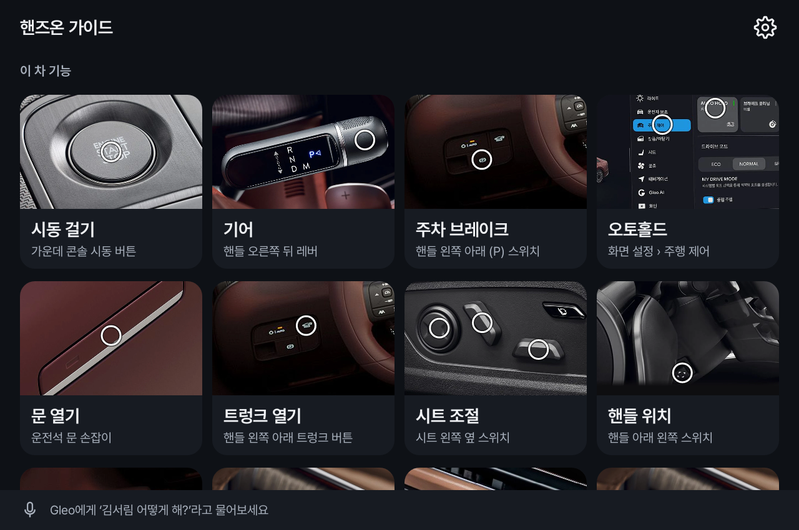
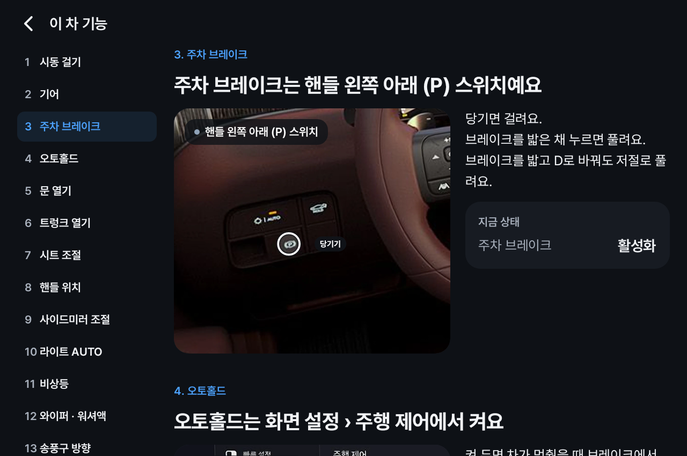

# 핸즈온 가이드 (Hands-on Guide)

처음 탑승하는 차량의 주요 기능과 조작법을 바로 찾아보고, 운전 중에는 필요한 순간에 음성으로 도와주는 운전 가이드

<p>
  
  
</p>

## 주요 기능

- 차량 기능 설명: 조작부 위치, 조작법, 현재 상태
- 도로 위 기본기: 도로 상황별 3D 장면과 안내
- 주행 중 안내: 차량 신호·내비 경로 기반 음성 안내
- Gleo 연동: 차량 기능 질문 시 해당 설명 열기

## APK

`apk/홍범순_handson-guide_release.apk`

## 테스트 환경

Pleos Connect 에뮬레이터 v2.1 (1920×1080)

## 실행 방법

```bash
adb install -r apk/홍범순_handson-guide_release.apk
```

- 기어 P: 기능 설명 화면
- 기어 D: 주행 화면 (Virtual Console로 변경)
- 시연 시나리오: 홈 왼쪽 위 앱 이름 5번 탭

## SDK

Vehicle 2.3.2, NaviHelper 3.0.5, TextToSpeech 3.3.1, SpeechToText 3.3.1, Gleo

## 빌드

```bash
./gradlew assembleRelease
```
